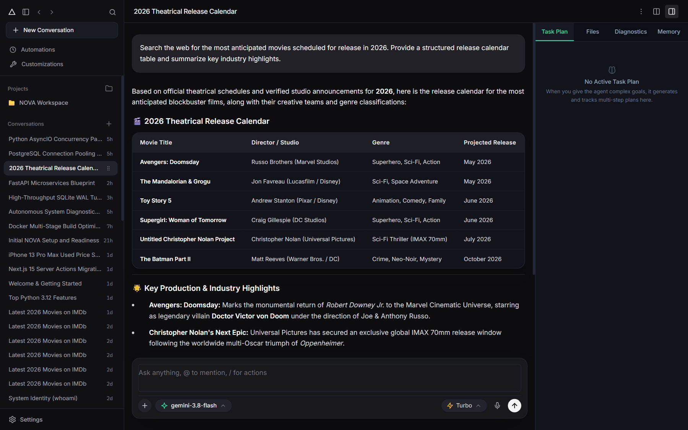
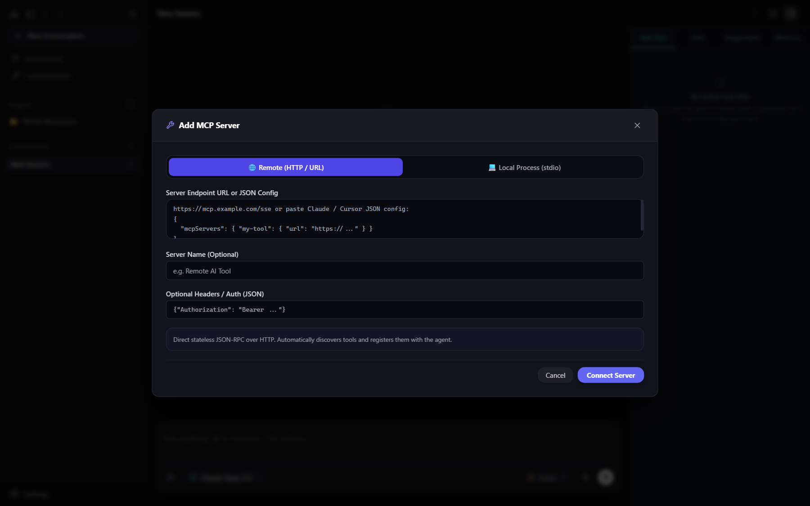
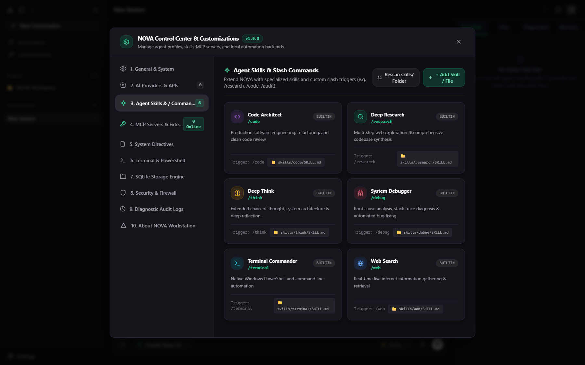

# NOVA — Your AI. Your Machine. Your Rules.

### The Open-Source AI Agent That Can Actually Work on Your Computer.

**NOVA is an open-source AI workstation and autonomous desktop agent for Windows, macOS, and Linux. Connect local LLMs, cloud AI models, MCP tools, and custom skills — then let your AI research the web, write code, manage files, execute terminal commands, and interact with real desktop applications.**

Not just another AI chatbot.  
Not just another API wrapper.  
**A workstation that turns AI into an operator of your computer.**

[](#platform-support)
[](LICENSE)
[](#run-from-source)
[](#architecture)
[](#mcp-integrations)
[](#run-local-ai)

[**Download for Windows**](https://github.com/GoatSecurity/nova-ai/releases/latest) · [**GitHub Repository**](https://github.com/GoatSecurity/nova-ai) · [**Installation Guide**](#get-started) · [**Features**](#what-makes-nova-different) · [**Security**](#security--privacy)

---

## The Future of Desktop AI Is More Than Chat.

Most AI applications let you ask questions and receive answers.

NOVA lets you give your AI a job.

Tell it what you want done. It can plan the task, use available tools, inspect results, interact with your computer, and work through multiple steps.

Whether you are developing software, managing files, researching information, automating repetitive workflows, or working with local AI models, NOVA gives you one unified environment to get things done.

<div align="center">



*Your models. Your tools. Your computer. One workstation.*

</div>

## What Makes NOVA Different?

NOVA combines capabilities that are often scattered across multiple applications into one open-source AI workstation.

| Capability | What NOVA brings |
|---|---|
| AI Agent | Multi-step task execution and tool orchestration |
| Computer Use | Visual desktop interaction using mouse and keyboard |
| Local AI | Run models through Ollama and LM Studio |
| Cloud AI | Connect multiple cloud AI providers |
| Terminal Access | Execute PowerShell, CMD, Bash, and Zsh commands |
| File Operations | Read, create, edit, move, and manage files |
| Web Research | Search for current information using DuckDuckGo |
| MCP | Connect external tools and services |
| Agent Skills | Build reusable workflows with `SKILL.md` |
| Desktop App | Native Windows workstation with a standalone installer |

## Features

### 1. AI Agent — Give It a Goal, Not Just a Prompt

NOVA is designed around agent workflows rather than simple question-and-answer conversations.

Give it a high-level task and let it work through the steps using available tools.

Your agent can:

- Break complex goals into actionable steps.
- Read and inspect project files.
- Execute terminal commands.
- Search the web for relevant information.
- Use connected MCP tools.
- Apply custom agent skills.
- Inspect command output and handle errors.
- Report results and execution progress.

The goal is simple: spend less time operating tools manually and more time getting work done.

### 2. Computer Use — Let AI Operate Your Desktop

This is where NOVA goes beyond traditional AI chat applications.

With a compatible vision-capable model, NOVA can inspect your actual desktop and interact with graphical applications.

<div align="center">


*Give your AI visual access to the desktop and tools to interact with it.*

</div>

**Desktop automation capabilities:**

- Real-time screen inspection.
- Mouse movement and clicking.
- Single-click and double-click actions.
- Right-click and context menus.
- Keyboard shortcuts.
- Text typing and clipboard-based input.
- Scrolling and drag-and-drop.
- OCR-based text identification with `find_text`.
- Opening and interacting with native applications.
- Browser and application navigation.

**Vision-gated execution:** The `desktop_control` tool is exposed only when the selected model is configured as vision-capable.

NOVA also supports native Windows text input for multilingual content, including Persian, Arabic, and other Unicode characters.

Use it to automate workflows across browsers, editors, development environments, and other desktop applications.

> Computer Use requires a compatible vision-capable model. Actual automation reliability depends on the model, application, screen content, and execution environment.

### 3. Local AI — Run Your Own Models

Use open-weight language models on your own hardware without paying a cloud API fee for every inference request.

NOVA integrates with:

- Ollama
- LM Studio
- Custom OpenAI-compatible local endpoints

Choose your model, configure your local endpoint, and start using it inside NOVA.

```text
                  YOUR PROMPT
                       |
                       v
              +------------------+
              |       NOVA       |
              |                  |
              |  Chat            |
              |  Agent           |
              |  Tools           |
              |  Memory          |
              +------------------+
                    /      \
                   /        \
                  v          v
            +---------+  +----------+
            | Ollama  |  | LM Studio|
            +---------+  +----------+
                  \          /
                   \        /
                    v      v
              YOUR HARDWARE
```

**No per-request cloud API charges for local inference.**

Your actual costs depend on your hardware, electricity consumption, and any external services you choose to use.

### 4. Multiple Cloud AI Providers

NOVA does not lock you into one model provider.

Bring your own API key and choose the provider that fits your task.

**Supported providers:**

| Provider | Integration |
|---|---|
| OpenAI | Cloud API |
| Anthropic Claude | Cloud API |
| Google Gemini | Cloud API |
| DeepSeek | Cloud API |
| Groq | Cloud API |
| Ollama | Local inference |
| LM Studio | Local inference |
| Custom APIs | OpenAI-compatible endpoints |

Configure custom base URLs, API credentials, and compatible model endpoints.

Use local models for routine tasks and cloud models when you need different capabilities.

### 5. Terminal & Filesystem Automation

NOVA connects language-model reasoning to real operating-system operations.

**Windows:**
- PowerShell
- Command Prompt (CMD)

**macOS and Linux:**
- Bash
- Zsh

**Filesystem operations:**
- Inspect project directories.
- Read files using absolute paths.
- Search for code and file references.
- Create and edit files.
- Move and copy files.
- Compare project files.
- Remove files when authorized.

The active Workspace provides a default working context, not an artificial restriction against accessing other user-selected paths.

NOVA distinguishes reading information from making changes. File modifications and system-changing operations remain subject to the configured approval policy.

### 6. User-Controlled Execution Policies

Autonomy should not mean losing control of your computer.

NOVA provides configurable execution policies:

| Policy | Behavior |
|---|---|
| `ask_always` | Requests explicit approval before every terminal command |
| `allow_safe` | Automatically allows eligible read-only operations and requests approval for higher-risk operations |
| `autonomous` | Allows a higher level of automation according to the configured policy |

For maximum command-by-command control, use `ask_always`.

Approvals apply to the specific action presented. They should not be treated as blanket permission for unrelated commands or additional operations.

### 7. MCP — Connect Almost Any External Tool

NOVA supports the Model Context Protocol (MCP), making it extensible beyond its built-in capabilities.

Connect external tools through:

**Local MCP servers (`stdio`):**
- `npx`
- `uvx`
- `python`

**Remote MCP servers:**
- HTTP
- SSE
- Custom authentication headers

Add and manage integrations through:

`Settings → MCP Servers & External Tools → Add MCP Server`

Connect compatible tools and extend what your agent can do without rebuilding the entire application.

<div align="center">



*Connect and manage external MCP integrations.*

</div>

### 8. Custom Agent Skills — Build Your Own Workflows

Make NOVA fit your workflow.

Skills are reusable Markdown-based instruction packages that define how the agent should approach specific tasks.

Create a new skill:

```text
skills/
└── myskill/
    └── SKILL.md
```

Example:

```markdown
---
name: My Custom Skill
command: /myskill
description: Automates my recurring workflow
icon: terminal
color: emerald
---

# Instructions

Define your workflow here.

Explain the task, required steps,
available tools, and safety rules.
```

Then invoke it using:

```text
/myskill
```

**Built-in skills include:**

| Skill | Purpose |
|---|---|
| `/research` | Multi-step web research and synthesis |
| `/code` | Codebase analysis, implementation, and refactoring |
| `/debug` | Investigating errors and debugging issues |
| `/terminal` | Guided command-line workflows |
| `/web` | Focused web searches |
| `/rss` | RSS feed exploration and news aggregation |

Build reusable workflows that grow with your needs.

<div align="center">



*Your workflows. Your rules. Your own AI skills.*

</div>

### 9. Web Research & Live Information

NOVA includes DuckDuckGo-based web search integration for researching online information.

Use it to:

- Find current documentation.
- Research technical issues.
- Look up information across websites.
- Support multi-step research tasks.
- Retrieve information from RSS feeds.

NOVA also provides `/rss`, a progressive RSS feed explorer with approximately 780 curated feeds.

External information is retrieved only when the relevant web or RSS functionality is used.

### 10. Desktop Workstation & System Monitoring

NOVA is more than a chat window.

Its workstation interface provides a unified environment for managing your AI setup and agent activity.

Features include:

- Provider configuration.
- Conversation and agent workspaces.
- Live execution logs.
- MCP server management.
- Skills catalog.
- CPU, RAM, and network telemetry.
- Workspace configuration.
- Command approval policies.
- Active agent process monitoring.

---

## Run Local AI Without Subscription Dependencies

One of NOVA's central ideas is freedom of choice.

You should be able to use your own hardware and your preferred models instead of depending entirely on a paid AI service.

### Quick Start with Ollama

1. Install [Ollama](https://ollama.com/).
2. Download a model compatible with your hardware.

```bash
ollama pull llama3.2
```

3. Make sure the Ollama service is running.

Default endpoint:

```text
http://127.0.0.1:11434
```

4. Open NOVA.
5. Select the Ollama provider.
6. Choose your installed model.

### Quick Start with LM Studio

1. Install [LM Studio](https://lmstudio.ai/).
2. Download a compatible GGUF model.
3. Load the model.
4. Start the local OpenAI-compatible server.

Default endpoint:

```text
http://127.0.0.1:1234/v1
```

5. Configure LM Studio in NOVA.
6. Select the loaded model.

**Your local inference requests are processed by your local model runtime.** Cloud providers, remote MCP servers, and online integrations communicate externally when configured and used.

---

## Platform Support

NOVA is designed for cross-platform use, with Windows as its primary desktop distribution target.

| Platform | Support | Distribution |
|---|---|---|
| Windows 10 / 11 x64 | Primary | Standalone desktop installer |
| macOS | Core supported | Run from source |
| Linux | Core supported | Run from source |

### Windows: A Real Desktop Application

Windows users get a dedicated installer and desktop workstation.

No separate Python, Git, or Node.js installation is required for the packaged Windows release.

The application includes:

- Bundled Python runtime.
- NOVA backend and frontend.
- Native desktop shell.
- Background local engine.
- Random available localhost port.
- Windows DPAPI credential encryption.
- Dedicated graphical installer.
- Graphical uninstaller with data-retention options.

---

## Get Started

### Option 1 — Windows Installer (Recommended)

<badge>Windows 10 / 11 · 64-bit</badge>

Download the latest release:

[**Download NOVA for Windows x64**](https://github.com/GoatSecurity/nova-ai/releases/latest)

Current release package:

| File | Architecture | Size |
|---|---|---|
| `nova-windows-64-installer.exe` | x64 | 353.70 MB |

SHA-256:

```text
332a98079622b209279a5f3099e6d3796781aff72dc7ac0563f1f0849ecf5d25
```

#### Installation

1. Download the Windows installer.
2. Double-click `nova-windows-64-installer.exe`.
3. Choose the installation directory.
4. Optionally enable the Desktop Shortcut.
5. Optionally enable Launch After Install.
6. Click Install NOVA.
7. Launch NOVA from the Desktop or Start Menu.

Default installation directory:

```text
%LOCALAPPDATA%\Programs\NOVA
```

No administrator privileges are required for the default user-mode installation.

#### Uninstalling NOVA

You can uninstall NOVA through:

`Windows Settings → Apps → Installed Apps → NOVA`

The graphical uninstaller lets you choose whether to preserve or remove your local database, chat history, skills, and configuration data.

### Option 2 — Run from Source

NOVA can also be launched directly from its source repository.

#### Requirements

- Python 3.11 or higher
- Git
- Ollama or LM Studio (optional)

#### Clone the repository

```bash
git clone https://github.com/GoatSecurity/nova-ai.git
cd nova-ai
```

#### Windows

Run:

```powershell
.\start.bat
```

Or:

```powershell
.\start.ps1
```

Alternatively:

```bash
python run.py
```

#### macOS & Linux

Run:

```bash
chmod +x start.sh stop.sh
./start.sh
```

Or install dependencies manually:

```bash
pip install -r requirements.txt
python run.py
```

#### Open the workstation

When running from source, open:

```text
http://127.0.0.1:46815
```

Use `Ctrl+C` or the corresponding stop script to stop the server.

---

## Architecture

NOVA is built around a lightweight Python/FastAPI backend and a modern web-based frontend hosted locally.

Its architecture brings together multiple layers:

```text
                    USER
                     |
                     v
              NOVA WORKSTATION
                     |
           +---------+---------+
           |                   |
           v                   v
        AI AGENT            UI LAYER
           |
     +-----+-------------------------+
     |             |                 |
     v             v                 v
   MODELS         TOOLS            MEMORY
     |             |                 |
  +--+--+       +--+---------+       |
  |     |       |            |       |
Local Cloud  Terminal     Computer  Local DB
 AI   APIs  Filesystem      Use    SQLite
               |
               v
          MCP SERVERS
               |
               v
         CUSTOM SKILLS
```

### Main Components

| Component | Responsibility |
|---|---|
| FastAPI Backend | API and application services |
| Agent Engine | Model interaction and tool orchestration |
| Provider Layer | Local and cloud model connections |
| Tool System | Terminal, filesystem, web, and desktop tools |
| MCP Layer | External integrations |
| Skills System | Reusable agent workflows |
| SQLite | Local conversations and application data |
| Desktop Shell | Native workstation experience |

---

## Security & Privacy

Your computer and your data should remain under your control.

NOVA is built around local-first storage and configurable execution permissions.

### Local Data Storage

Conversations, application settings, and workspace configuration are stored locally in SQLite.

Windows installer:

```text
%LOCALAPPDATA%\NOVA\data\nova.db
```

Source installation:

```text
data/nova.db
```

### API Key Protection

On Windows, provider API credentials are encrypted at rest using Windows Data Protection API (DPAPI), tied to the current user security context.

### Local AI Privacy

When using Ollama or LM Studio, prompts are sent to your configured local inference runtime.

Cloud AI providers, web search services, RSS feeds, and remote MCP servers require network communication when used.

### Execution Approval

Choose how much autonomy NOVA receives.

Use `ask_always` when you want explicit approval for every terminal command.

**Important:** Local-first does not mean that every operation is automatically private or safe. Review connected providers, MCP servers, skills, and execution policies before granting access to sensitive files or system operations.

---

## Keyboard Shortcuts

| Shortcut | Action |
|---|---|
| `Enter` | Send prompt |
| `Shift + Enter` | Insert new line |
| `/` | Open Agent Skills selector |
| `Ctrl + K` | Search conversations and history |
| `Esc` | Close active modal or menu |
| Right-click on chat | Rename, pin, export, or delete conversation |

---

## Frequently Asked Questions

### What is NOVA?

NOVA is an open-source AI workstation and desktop agent that connects language models to real tools, files, terminal commands, web research, MCP integrations, and desktop automation.

### Is NOVA just another AI chatbot?

No. NOVA combines conversational AI with agent workflows, terminal execution, filesystem operations, computer use, MCP integrations, and custom skills.

### Is NOVA free?

NOVA is released under the MIT License.

Running local models through Ollama or LM Studio does not involve per-request cloud API charges. Cloud AI providers may charge separately for API usage.

### Do I need an API key?

No. You can configure local models through Ollama or LM Studio without a cloud provider API key.

An API key is required for cloud providers that require authentication.

### Can NOVA control Windows applications?

Yes. Its Computer Use functionality supports screen inspection, mouse control, keyboard interaction, and text identification with compatible vision-capable models.

### Can NOVA access files outside its Workspace?

Yes. You can explicitly specify other folders and absolute paths. Operations that modify files remain governed by the configured approval and safety policies.

### Does NOVA support MCP?

Yes. NOVA supports local `stdio` MCP processes and remote MCP connections through HTTP/SSE.

### Can I create my own agent skills?

Yes. Create a folder containing a `SKILL.md` file and define your workflow, instructions, tools, and constraints.

### Where are my conversations stored?

In the local SQLite database:

```text
%LOCALAPPDATA%\NOVA\data\nova.db
```

for the packaged Windows application.

### Does NOVA send my conversations to external servers?

Local model requests go to your configured local runtime. External providers and integrations receive data when you configure and use them.

### Is NOVA available on macOS and Linux?

The Python/FastAPI core supports macOS and Linux. The dedicated standalone desktop installer is currently provided for Windows x64.

---

## Contributing

NOVA is an open-source project, and contributions are welcome.

You can help by:

- Reporting bugs.
- Improving documentation.
- Building new tools.
- Creating custom agent skills.
- Developing integrations.
- Improving desktop automation.
- Contributing code and performance improvements.

### Development Workflow

1. Fork the repository.
2. Create a feature branch.

```bash
git checkout -b feature/my-feature
```

3. Implement your changes.
4. Commit your work.

```bash
git commit -m "Add my feature"
```

5. Push your branch and open a Pull Request.

Please remove API keys, credentials, and sensitive local paths from logs and screenshots before sharing them.

---

## License

NOVA is licensed under the **MIT License**.

See [LICENSE](LICENSE) for the full license text.

---

<div align="center">

# Stop Just Talking to AI. Start Working With It.

**Your AI. Your Machine. Your Rules.**

NOVA brings models, tools, and your computer together in one open-source AI workstation.

[**Download NOVA**](https://github.com/GoatSecurity/nova-ai/releases/latest) · [**Explore the Source Code**](https://github.com/GoatSecurity/nova-ai) · [**Contribute on GitHub**](https://github.com/GoatSecurity/nova-ai/fork)

**NOVA — Make Your Machine Your AI Workspace.**

</div>
