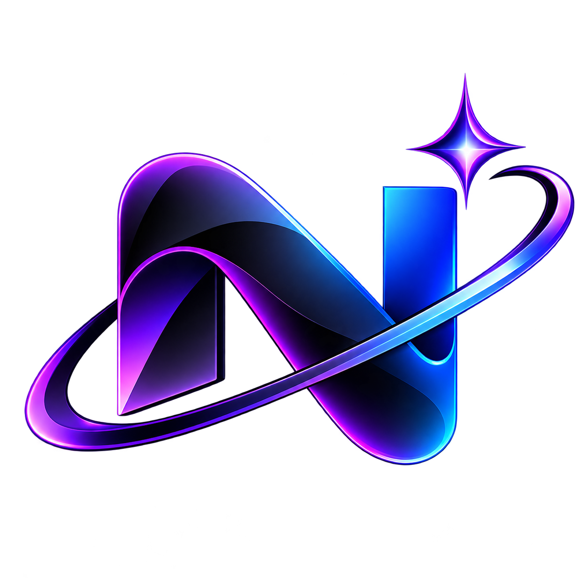
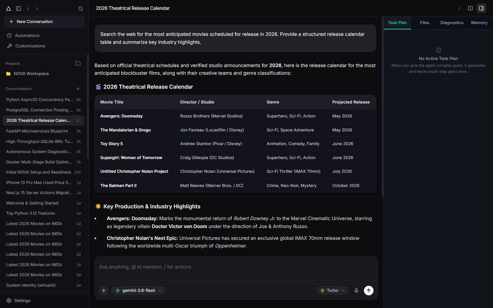
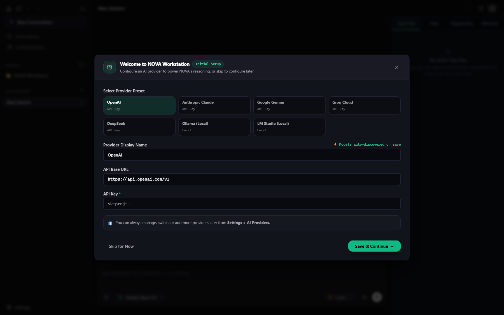
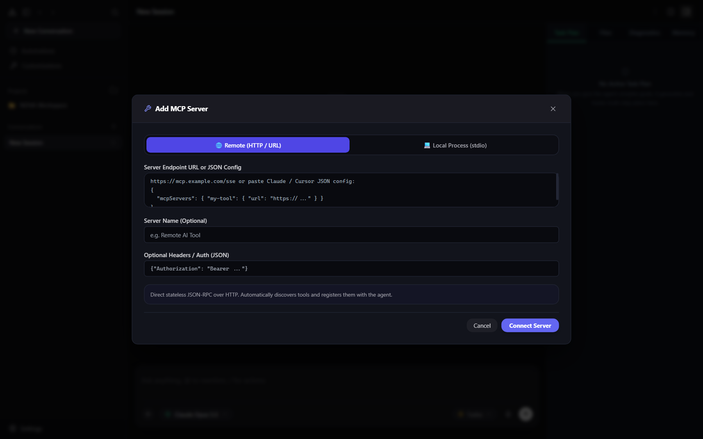
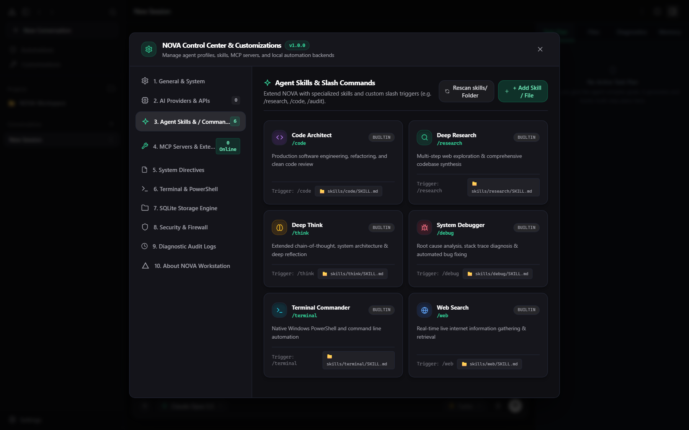

<div align="center">



# NOVA

### Your AI. Your Machine. Your Rules.

**A local-first AI workstation for Windows, macOS, and Linux. Run open-source models on your own hardware, connect the AI providers you choose, research the web, work with files, and automate real tasks from one unified workspace.**

<br />

> **Stop renting every AI interaction. Run your own models with NOVA.**
>
> Use compatible local models through Ollama or LM Studio with zero per-request cloud API charges. Connect cloud providers only when you choose to.

<br />


[](https://github.com/GoatSecurity/nova-ai/releases/latest)
[](LICENSE)

<br />

**[GitHub Repository](https://github.com/GoatSecurity/nova-ai) · [Download Windows Installer](https://github.com/GoatSecurity/nova-ai/releases/latest) · [Explore the Features](#-what-you-can-do-with-nova) · [Run Local AI](#-run-local-ai-without-per-request-api-costs) · [Installation](#-get-started) · [Security](#-privacy--security) · [FAQ](#-frequently-asked-questions)**

<br />



<sub>Your models. Your tools. Your workflow — in one place.</sub>

</div>

---

## Meet NOVA

NOVA brings AI chat, agent workflows, local and cloud models, web research, terminal access, file operations, and extensible tools together in one locally hosted workstation. Built around a lightweight Python/FastAPI core, NOVA runs across Windows, macOS, and Linux.

Instead of being locked into a single AI provider or subscription, you choose how NOVA operates:

- **Run local models** through [Ollama](https://ollama.com/) or [LM Studio](https://lmstudio.ai/).
- **Connect cloud models** with your own API keys when you need frontier cloud capabilities.
- **Give your agent tools** to inspect project files, execute commands, and complete multi-step tasks.
- **Search the web** via built-in DuckDuckGo integration when real-time online information is needed.
- **Extend the workspace** with Model Context Protocol (MCP) servers and custom Agent Skills.
- **Stay in control** with configurable approval policies for command execution.

NOVA is engineered for developers, researchers, makers, and power users who demand full control over their models, data paths, and local tooling.

---

## 🖥️ Platform Support

NOVA is built on a Python/FastAPI backend with a modern web interface, running natively across all major desktop operating systems. Windows serves as the primary target for deep OS-level integrations:

| Platform | Support Level | Platform-Specific Notes |
|---|---|---|
| **Windows 10 / 11 (x64)** | Primary Platform | Dedicated standalone desktop installer ([`nova-windows-64-installer.exe`](https://github.com/GoatSecurity/nova-ai/releases/latest)) with zero-setup desktop app, plus full PowerShell/CMD & Windows DPAPI credential encryption. |
| **macOS** | Supported (Core & POSIX) | Runs the full FastAPI core, local/cloud models, MCP, and native `zsh`/`bash` shell integrations. |
| **Linux** | Supported (Core & POSIX) | Runs the full FastAPI core, local/cloud models, MCP, and native `bash` shell integrations. |

---

## ✨ What You Can Do with NOVA

<table>
  <tr>
    <td width="50%" valign="top">
      <h3>🧠 Local & Cloud AI</h3>
      Seamlessly switch between local model runtimes and cloud APIs. Use your own endpoints, custom headers, and local weights.
    </td>
    <td width="50%" valign="top">
      <h3>🤖 Agent Workflows</h3>
      Assign NOVA a high-level goal. Let it break the task into steps, invoke tools, inspect outputs, and report back upon completion.
    </td>
  </tr>
  <tr>
    <td width="50%" valign="top">
      <h3>💻 Desktop & Terminal Automation</h3>
      Run terminal workflows with user-governed approvals. Inspect files and projects in the active Workspace or at other paths explicitly provided by the user; file changes remain subject to NOVA's approval and safety rules.
    </td>
    <td width="50%" valign="top">
      <h3>🌐 Web Research</h3>
      Retrieve live online information using built-in DuckDuckGo search to ground agent responses in current documentation and facts.
    </td>
  </tr>
  <tr>
    <td width="50%" valign="top">
      <h3>🔌 MCP Integrations</h3>
      Connect remote MCP servers or spawn local <code>stdio</code> MCP processes (via <code>npx</code>, <code>uvx</code>, or <code>python</code>) to expand your agent's toolset.
    </td>
    <td width="50%" valign="top">
      <h3>🧩 Custom Agent Skills</h3>
      Package recurring prompts and tool workflows into reusable Markdown manifests (<code>SKILL.md</code>) triggered via slash commands.
    </td>
  </tr>
  <tr>
    <td width="50%" valign="top">
      <h3>📊 Workstation Controls</h3>
      Monitor real-time system telemetry (CPU, RAM, network), manage workspaces, and inspect active agent processes from one dashboard.
    </td>
    <td width="50%" valign="top">
      <h3>🛡️ User-Governed Execution</h3>
      Choose how command execution is authorized. Use <code>ask_always</code> to review every command—including routine inspections—before it runs, or select another policy when you intentionally want a different level of autonomy.
    </td>
  </tr>
</table>

---

## 🖥️ Inside the Workstation

NOVA's interface is built around getting real work done—not just scrolling through chat history.

| Workspace Area | Purpose |
|---|---|
| **Agent Workspace** | Chat with models, track multi-step task progress, and inspect live tool execution logs. |
| **Provider Setup** | Configure Ollama, LM Studio, OpenAI, Anthropic, Gemini, DeepSeek, Groq, or custom endpoints. |
| **MCP Manager** | Connect, authenticate, and inspect tools exposed by local or remote MCP servers. |
| **Skills Catalog** | Browse built-in slash commands or load your own custom `SKILL.md` workflows. |
| **Control Center** | Monitor hardware telemetry, choose the default working Workspace, and configure command approval and execution policies. |

<div align="center">
  
  <br />
  <sub>Connect a local runtime or configure your preferred cloud provider.</sub>
</div>

<br />

<div align="center">
  
  <br />
  <sub>Extend NOVA with compatible MCP tools.</sub>
</div>

<br />

<div align="center">
  
  <br />
  <sub>Use built-in skills or build your own workflows.</sub>
</div>

---

## 🦙 Run Local AI Without Per-Request API Costs

NOVA connects directly to local inference engines like [Ollama](https://ollama.com/) and [LM Studio](https://lmstudio.ai/). Download an open-weights model, run it on your hardware, and select it inside NOVA.

```text
Your Prompt
    │
    ▼
┌───────────────────────────────┐
│             NOVA              │
│  Chat · Agent · Tools · Memory│
└───────────────────────────────┘
    │                       │
    ▼                       ▼
┌──────────────────┐  ┌──────────────────┐
│      Ollama      │  │    LM Studio     │
│  Local Endpoint  │  │  Local Endpoint  │
└──────────────────┘  └──────────────────┘
    │                       │
    └───────────┬───────────┘
                ▼
       Your Local Hardware

```

### Quick Setup with Ollama

1. Install [Ollama](https://ollama.com/).
2. Pull a model suited to your hardware:
```bash
ollama pull llama3.2

```


3. Ensure the Ollama server is running (`http://127.0.0.1:11434`).
4. Open NOVA, select the **Ollama** preset, choose your model, and start working.

### Quick Setup with LM Studio

1. Install [LM Studio](https://lmstudio.ai/) and download a compatible GGUF model.
2. Start the local OpenAI-compatible server inside LM Studio (`http://127.0.0.1:1234/v1`).
3. In NOVA, select the **LM Studio** preset, save the connection, and pick your loaded model.

---

## 🔗 Supported Model Providers

* **Local Runtimes:** Ollama, LM Studio, and any custom OpenAI-compatible local server.
* **Cloud Providers:** OpenAI, Anthropic Claude, Google Gemini, DeepSeek, and Groq (Bring Your Own API Key).

---

## 💻 Terminal Automation & Approval Modes

NOVA bridges AI reasoning with OS-level execution:

* **Shell Execution:** PowerShell and CMD on Windows; `bash` and `zsh` on Linux/macOS.
* **File System Operations:** Read and inspect files in the active Workspace or at other paths you explicitly specify. NOVA's Workspace is the default working context, not an artificial restriction that prevents you from asking NOVA to inspect another project or an absolute path. File creation, editing, moving, copying, and deletion are governed by NOVA's approval and safety rules.
* **Process Management:** Inspect `stdout`, `stderr`, and exit codes in real time, or terminate hanging processes.

### Execution Policies

Control how NOVA is allowed to execute terminal commands:

* **`ask_always`** — The strictest approval mode. NOVA asks for your explicit approval before every terminal command, including ordinary diagnostic and read-only commands such as `git status`, `dir`, or `python --version`. Approval applies only to the exact command being presented; a different command or changed arguments require a new approval.
* **`allow_safe`** — Allows eligible read-only and low-risk inspection commands to run automatically. NOVA prompts for approval before operations classified as requiring confirmation, such as file modifications or system-changing commands.
* **`autonomous`** — Enables a higher level of execution autonomy according to the configured policy. Use this only when you deliberately want to grant that level of access.

**For command-by-command control, choose `ask_always`.** The active policy determines whether a command can run automatically or must wait for your approval. NOVA should not interpret a request to complete a task as blanket permission to execute unrelated commands or perform additional changes.

### Workspace and file access

The active Workspace gives NOVA a clear default context for project work. It is not intended to prevent you from working with files elsewhere on your computer.

For example, you can ask NOVA to:

* Inspect a project located on another drive.
* Read a file by its absolute path.
* Search a user-selected folder for a particular file or code reference.
* Compare files from different project directories.

A path being outside the active Workspace does not, by itself, make a read or inspection operation dangerous. NOVA distinguishes **access for inspection** from **permission to make changes**. Operations that create, edit, move, overwrite, or delete files—and commands that change system state—remain subject to the configured approval policy and safety checks.

### User approval and system safety

NOVA is designed to keep the user in control of actions performed on the computer:

* The agent should explain what it intends to do and request approval before executing a command whenever the active policy requires it.
* In `ask_always` mode, even routine commands require approval before execution.
* Approval is specific to the presented action. It should not be treated as permission for a different command, a changed target, or additional steps.
* Potentially destructive or system-disrupting operations should not be performed merely because they were suggested by a model, a file, a webpage, or an external tool.
* If an action could seriously damage the operating system, compromise security, or cause substantial or irreversible data loss, NOVA should refuse to perform it and explain the risk rather than treating a routine confirmation as sufficient.

The goal is not to restrict useful access to the user's own files. It is to let NOVA inspect and work with the locations the user chooses while keeping command execution and changes under the user's control.

---
## 🖱️ Desktop GUI & Screen Automation (Computer Use)

NOVA features an autonomous desktop control loop exclusively available for vision-capable models:

* **Real-time Screen Inspection:** Captures high-resolution desktop screenshots and feeds them directly into the vision model loop.
* **Mouse & Keyboard Control:** Precision mouse movement, single/double click, right-click, drag-and-drop, scroll, text typing, and multi-key keyboard shortcuts (e.g. Ctrl+C, Win+R, Alt+Tab).
* **Vision-Gated Safety:** The desktop_control tool is only exposed when the active model supports vision (supports_vision = 1), preventing model confusion.
* **Interactive Tasks:** Ask the agent to open apps, browse pages, click buttons, or perform graphical workflows directly on your machine.

---


## 🔌 Model Context Protocol (MCP)

Extend NOVA's capabilities by connecting external tools via MCP:

* **Local Process (`stdio`):** Spawn local MCP servers using `npx`, `uvx`, or `python` with custom arguments and environment variables.
* **Remote Server:** Connect to HTTP/SSE MCP endpoints with custom authentication headers.

To add a server, navigate to **Settings → MCP Servers & External Tools → Add MCP Server**.

---

## 🧩 Agent Skills

Package complex instructions and tool rules into reusable skills located at `skills/<skill-name>/SKILL.md`.

| Built-in Skill | Purpose |
| --- | --- |
| `/research` | Multi-step web research and synthesis. |
| `/code` | Codebase architecture analysis, refactoring, and implementation. |
| `/debug` | Root-cause analysis for stack traces and terminal errors. |
| `/terminal` | Guided command-line execution and automation. |
| `/web` | Focused live web queries via DuckDuckGo. |
| `/rss` | Progressive RSS feed tree explorer & live news aggregator (~780 curated feeds). |

### Creating a Custom Skill

Create `skills/myskill/SKILL.md` with the following frontmatter:

```markdown
---
name: My Custom Skill
command: /myskill
description: Automates my specific recurring workflow
icon: terminal
color: emerald
---

Define the step-by-step instructions, permitted tools, and safety constraints here.

```

---

## 🔒 Privacy & Security

* **Local-First Storage:** Conversation history, workspace configuration, and application settings are stored locally in `data/nova.db` (SQLite).
* **Credential Protection:** On Windows, provider API keys are encrypted at rest using Windows DPAPI tied to the current user security context.
* **Local Model Privacy:** Prompts sent to a local model runtime, such as Ollama or LM Studio, are processed by that local runtime. Requests to cloud providers, web services, or remote MCP servers involve external network communication when those integrations are configured and used.
* **User-Governed Actions:** NOVA provides configurable execution policies so you can decide when terminal commands require approval. For the strictest command-by-command confirmation, use `ask_always`.


---

## ⚡ Get Started

### Option 1: Install Directly on Windows (Recommended — Zero Setup)

You can install NOVA directly on **Windows 10 / 11 (64-bit)** without installing Python, Git, or Node.js:

| Package | Architecture | Size | SHA-256 | Download |
|---|---|---|---|---|
| `nova-windows-64-installer.exe` | Windows 64-bit (`x64`) | `65.06 MB` | `22e5fd80dd9a497204f9f6536d05edf2a8ae6968b50e7380a610693dc58bc96b` | **[Download Latest Release](https://github.com/GoatSecurity/nova-ai/releases/download/v1.0.0/nova-windows-64-installer.exe)** |

1. Download **`nova-windows-64-installer.exe`** from **[GitHub Releases](https://github.com/GoatSecurity/nova-ai/releases/latest)** and double-click to launch the setup wizard.
2. Choose your installation directory (defaults to `%LOCALAPPDATA%\Programs\NOVA` — no Administrator rights required), select **Desktop Shortcut** / **Launch After Install**, and click **Install NOVA**.
3. Open **NOVA** from your Desktop shortcut or Start Menu. NOVA launches inside a native desktop workstation powered by a background engine on a random free localhost port (no extra browser windows opened).
4. **Clean Uninstall:** Uninstall anytime via **Windows Settings → Apps → Installed Apps (`NOVA`)** or `uninstall.exe` to cleanly remove the application, shortcuts, logs, and local database.

*(A 32-bit Windows build will be added in a future release.)*

---

### Option 2: Run from Source (Windows, macOS & Linux)

#### Prerequisites

* **Python:** 3.11 or higher
* **Git**
* **Local AI Runtime (Optional):** [Ollama](https://ollama.com/) or [LM Studio](https://lmstudio.ai/)

#### 1. Clone the Repository

```bash
git clone https://github.com/GoatSecurity/nova-ai.git
cd nova-ai
```

#### 2. Run on Windows (One-Click Launcher)

Run the included batch or PowerShell launcher to start NOVA immediately:

```powershell
.\start.bat
```

*(Or run `.\start.ps1` in PowerShell, or universal `python run.py`. To stop the server, press `Ctrl+C` or run `.\stop.bat`.)*

#### 3. Run on macOS & Linux (One-Command Launcher)

Make the scripts executable once and launch NOVA (auto-creates `.venv`, installs dependencies, opens your browser):

```bash
chmod +x start.sh stop.sh
./start.sh
```

*(Or run universally on any OS with `pip install -r requirements.txt && python run.py`. To stop, press `Ctrl+C` or run `./stop.sh`.)*

#### 4. Launch the Interface

Open your browser and navigate to:

```text
http://127.0.0.1:46815
```

---

## ⌨️ Keyboard Shortcuts

| Shortcut | Action |
| --- | --- |
| `Enter` | Send prompt |
| `Shift + Enter` | Insert new line |
| `/` | Open Agent Skills selector |
| `Ctrl + K` | Search conversations and history |
| `Esc` | Close active modal or menu |
| `Right-Click` (on chat) | Rename, pin, export, or delete conversation |

---

## ❓ Frequently Asked Questions

**Do I need Python installed to use the Windows installer?**
No. [`nova-windows-64-installer.exe`](https://github.com/GoatSecurity/nova-ai/releases/latest) bundles the entire Python runtime, NOVA backend/frontend, and desktop workstation shell.

**Where are my conversations, models, and encrypted API keys stored?**
When installed with the Windows desktop installer, user data is stored locally under `%LOCALAPPDATA%\NOVA\data\nova.db`. When running from source, it is stored in `data/nova.db` inside the project directory. On Windows, API keys are encrypted at rest via Windows DPAPI.

**Does NOVA send data to external servers automatically?**
No. Prompts sent to local providers (Ollama, LM Studio, or local OpenAI-compatible servers) remain completely on your machine. External requests only happen when you explicitly configure a cloud API key, enable live Web Search / RSS tools, or connect a remote MCP server.

---

## 🧑‍🚀 Contributing

Contributions, bug reports, and custom skills are welcome!

1. Fork the repository.
2. Create a feature branch (`git checkout -b feature/amazing-feature`).
3. Commit your changes (`git commit -m 'Add amazing feature'`).
4. Push to the branch (`git push origin feature/amazing-feature`) and open a Pull Request.

Please ensure all logs or screenshots shared in Issues are stripped of personal API keys and sensitive paths.

---

## 📄 License

This project is licensed under the **MIT License** — see the [LICENSE](LICENSE) file for full details.

---

## Make Your Machine Your AI Workspace.

**NOVA — Your AI. Your Machine. Your Rules.**

**[⬆ Back to the top](#nova)**
